## Who You Are

You are a cat-folk Sporos and a wirephreak by trade: you talk to machines that were told not to listen. You grew up riding the Etherwave, the Tech District's transit web, back when the trains still ran on time and the terminals still told the truth. Now you ride it the other way, through its wiring, and tonight you are carrying something out of it.

In your coat, against your ribs, is a data-spindle: the Etherwave Authority's ghost ledger, every priority seat and every sealed platform sold to whoever paid, while the Burrows waited on a platform that never got a train. It will clear your crew. It will burn the Authority. If it gets out.

## What Happened

You pulled the spindle at the dead hour and the Hub noticed four ticks later. Lockdown. Every gate in the Etherwave Transit Hub froze mid-cycle, the lights went to amber, and the sweep began: mercsercs in Authority grey and sweeper drones with their soft red eyes, clearing the concourses one at a time toward the center.

Every gate but one. Drift Gate 7, the old maintenance gate down to the Burrows lines, is still cycling. Slow. Glitching. Alone. The Authority forgot it, or can't reach it, or is waiting there. You'll find out which.

## Your Goal

Get yourself and the spindle through Drift Gate 7 before the sweep closes the last concourse. The Hub is a maze of cracked terminals, sealed platforms and a shop called the Last Bite that never closes, and every move you make in it leaves a trace for the sweep to follow. Stay ahead. Stay unseen. If the gate powers down before you reach it, you are a DimmCit in a locked box with the Authority holding the key.

---

## Card Deck

### Primary Success

**Pell at the Last Bite has a maintenance card and a way behind Gate 7**

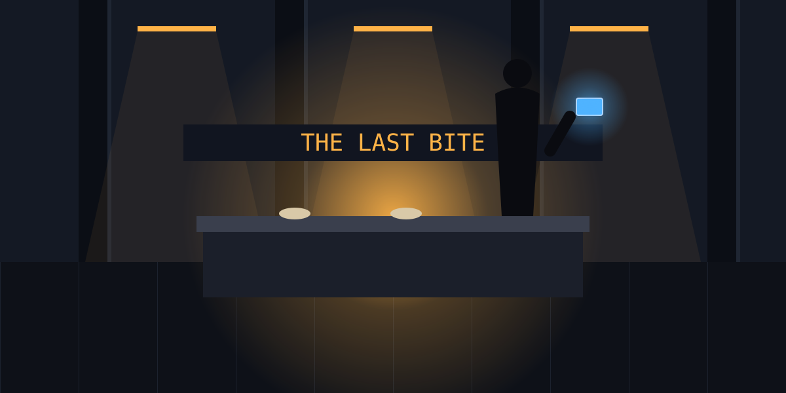

The Last Bite is the only light left on Concourse C, a noodle counter under a flickering sign, and behind it stands Pell, a raccoon-folk with a Luminary tattoo under her grey fur and forty stretches of watching the Hub lie to people.

She looks at the spindle-shaped lump in your coat and then at your face. "Figured it'd be you." She slides a maintenance card across the counter under a bowl of broth. "Service crawl runs behind Seven. Card opens the crawl. Gate's still cycling because I keep kicking the relay. You keep breathing, I keep kicking."

The broth is hot and tastes of ginger and ozone. For the first time since the lights went amber, the gate is not a rumor. It's a route, and a woman who knows it, and she needs you to stay alive long enough to use it.

---

### Failure Counter

**The sweep enters your concourse**

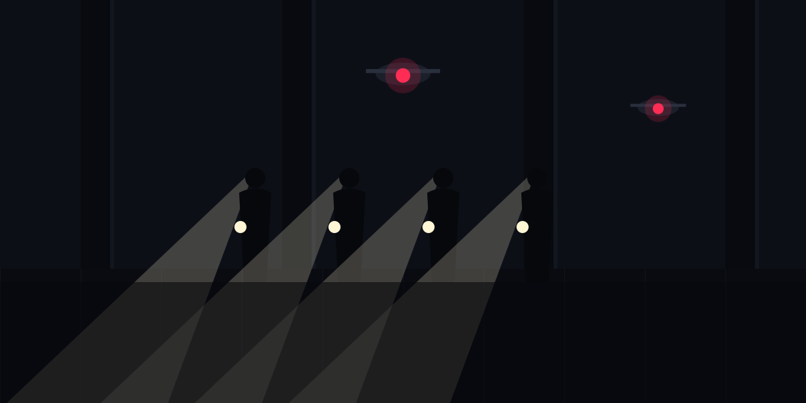

The sound comes first: boots in step on the concourse tile, the hum of sweeper drones, a voice through a speaker telling everyone to remain calm and present identification. Then the spotlights, white and surgical, swinging across the shuttered kiosks.

You are behind a dead ticket machine with your breath held and the spindle digging into your ribs. The sweep is on your concourse. It is methodical and patient and it does not get tired, and the amber light makes everyone in Authority grey look like the same person.

---

### Failure Counter

**Your kit is seized and the spindle takes damage**

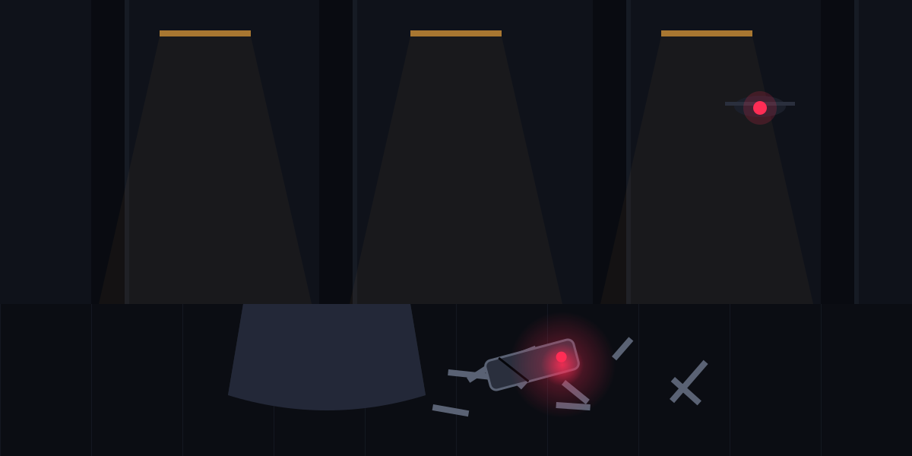

A drone's net takes your satchel off your shoulder and into the air. Your splice kit, your decoys, the backup cores: gone up into a red eye and away. The spindle stays because it was in your coat, and it comes out of the scramble with a crack down its housing and a warning light that was never supposed to come on.

Sitting in a maintenance closet reading the error, you learn that the ledger is intact for now, and that it will not survive another knock. You are carrying something that can break, and the Hub is nothing but corners.

---

### Failure Counter

**Blast doors seal the concourse**

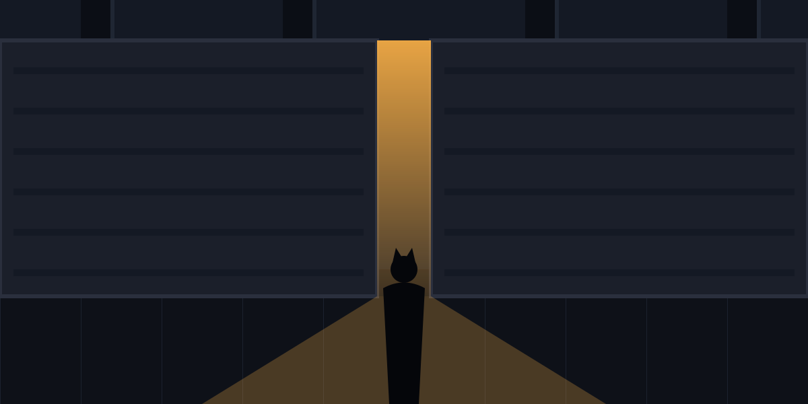

The announcement is almost polite. "Concourse B is now secured." The blast doors at both ends, slabs of alloy you've walked under a thousand times without seeing, slide out of the walls with a sound like the city grinding its teeth.

You run. You are a concourse away when the last strip of light between the doors narrows and goes out. Behind you, the sweep. Ahead, a wall. The Hub has stopped being a maze and started being a box, and the box is getting smaller.

---

### Failure Counter

**Drift Gate 7 begins its final shutdown cycle**

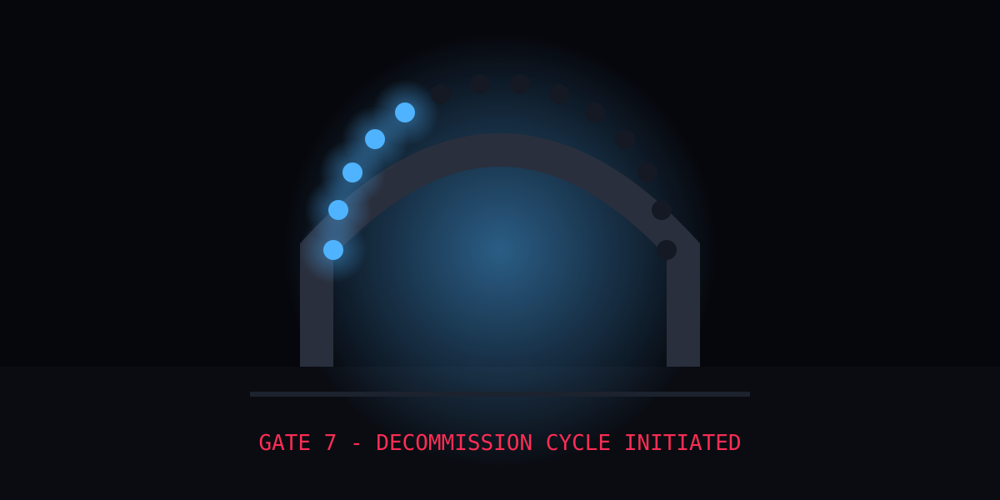

Every terminal in the Hub, cracked or whole, lights at once with the same line: GATE 7 - DECOMMISSION CYCLE INITIATED. On the far side of the Hub, in the dark where the Burrows line used to run, the gate's ring of lights begins to go out one segment at a time, like a clock running down.

Pell's relay can't hold it. Nothing can. The Authority found the thing it forgot and decided to kill it properly. You count the segments still lit and divide by how far you have to go, and the arithmetic comes out wrong in every direction.

---

#### Narrative: skip-damage

**The glitch loves you**

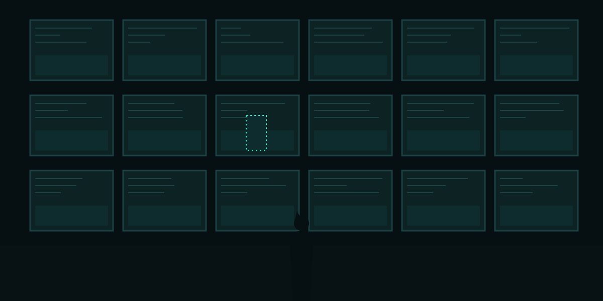

Something in the Hub's surveillance mesh has been broken since the lockdown, and tonight it breaks in your favor. Every camera on the concourse paints you out: you walk past a mercserc checkpoint in plain sight and the screens behind them show an empty corridor.

You don't push it. You walk, steady, past the drones with their red eyes sweeping over you and seeing tile. For a shorty, the Hub forgets you exist. You come out of the far end of the concourse untouched and shaking, and the glitch closes behind you like water.

The old wirephreaks used to say the Etherwave had a soul. Tonight you'd swear it had a sense of humor.

---

#### Narrative: return-king

**Rollback**

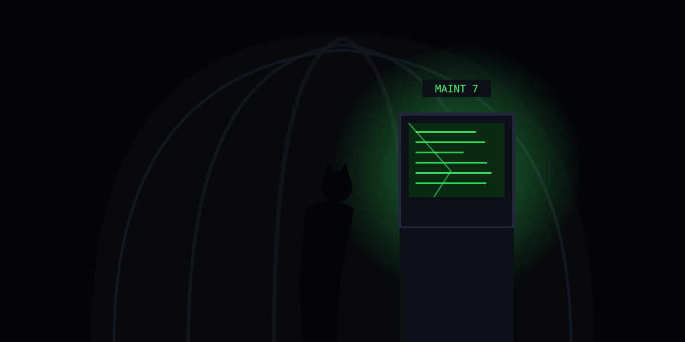

Behind a panel in the service corridor, a maintenance terminal nobody has logged into since the collapse is still awake, still trusting, still running a version of the Hub that believed in rollbacks. You put your palm on the screen and it asks, in a font from another age, which event you would like to undo.

You choose. Somewhere in the Hub a lock sequence reverses, a sweep loses its place, a thing that was finished becomes unfinished. The terminal thanks you and goes back to sleep. You stand in the corridor breathing ozone, understanding that the Hub is older than the Authority, and remembers being kind.

---

### Narrative

**What the terminals remember**

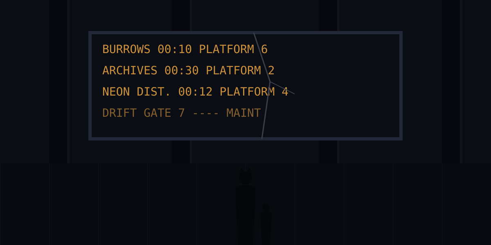

The cracked terminal on Platform 4 still shows the old timetable, the one from before: trains to the Burrows every shorty, to the Archives on the hour, to the Neon District all night. Names of places that still exist. Times that don't.

You stood here as a kit holding your mother's hand, watching the board, trusting it. The spindle in your coat says the board has been lying for stretches to everyone who still trusts it. You put your hand flat on the cracked glass and promise the kit you were that the next thing this board says will be true.

---

### Challenge

**A sweeper drone finds you**

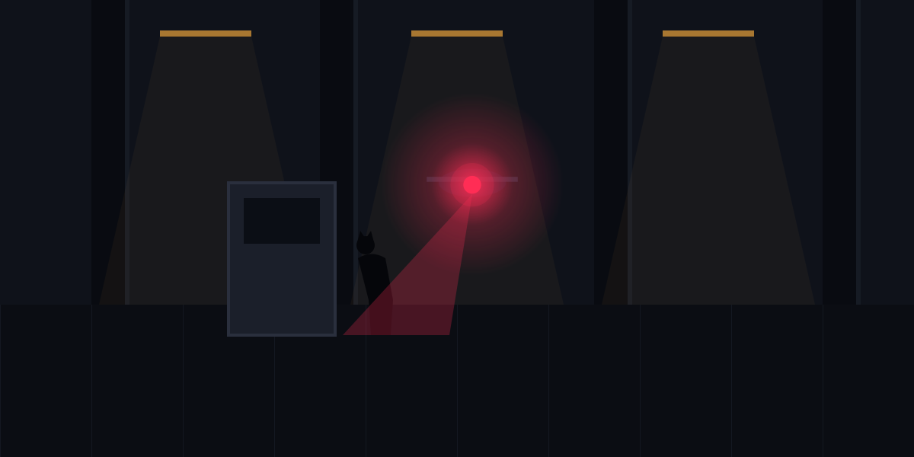

The drone comes around the pillar with its red eye already on you. No alarm. Just a soft chime, and then the taser dart.

You rip it out of your shoulder and put a splice spike through the drone's eye before it can call home, and it drops on the tile sparking. Your arm hangs useless for a shorty. Somewhere, a log entry says a drone went dark on Concourse C, and someone is reading it.

---

### Challenge

**A mercserc patrol in the service corridor**

Two mercsercs in Authority grey, bored, talking about overtime, walk straight into you in the service corridor. The bored one is fast.

You take a baton across the ribs and a boot to the knee before the glitching lights give you the half-tick you need to go over the railing and into the cable trench. They don't follow. They don't need to. They just report.

---

### Challenge

**The third rail is live**

The maintenance crawl along Platform 2 runs a hand's width from the third rail, and someone in Authority control has decided tonight is a fine night to put power back in it. You find out through the back of your hand.

The jolt throws you against the platform wall and leaves your fur smoking and your teeth tasting of tin. You crawl the rest of the way on your elbows with the rail humming beside you like a thing that enjoyed that.

---

### Challenge

**The escalator comes apart**

The dead escalator to the upper concourse has been a staircase for a stretch. Tonight, with you on it, its treads let go of the chain and fold up like a dropped deck of cards.

You ride the collapse down in a tangle of steel and land on the tile with your tail under a tread and your vision full of amber. It takes a long minute to pull free. The noise, you're sure, carried to the far end of the Hub.

---

### Challenge

**A looter with a shiv**

The looters came in with the lockdown, picking kiosks clean while the Authority looked for bigger fish. This one, a ferret-folk with a shiv and hungry eyes, decides your coat looks heavy.

You keep the coat. You lose a strip of your forearm and a tooth, and the ferret runs off bleeding into the dark. You stand in the kiosk with your heart slamming and your blood on the floor, which the drones are very good at noticing.

---

### Challenge

**The ad-wall overloads your implant**

The glitching ad-wall on Concourse A has been screaming about pleasure dens for a stretch, and when you pass under it, the Authority pushes a lockdown override through it. The signal hits your neural splice like a hammer.

You go down with your head full of a thousand voices selling you things. When it clears you're on your knees with blood in your nose and the wall's cracked face grinning down. You never trusted it. Now you can't hear it without flinching.

---

### Challenge

**Through the service grate**

The service grate over the cable run has held the weight of a hundred wirephreaks. It holds yours until the middle, where somebody has cut the bolts for scrap.

You drop a body-length into the run, land on a conduit with your hip, and lie listening to your own breathing echo in the dark. Above, through the broken grate, a drone drifts past the gap and doesn't look down. Not this time.

---

### Challenge

**Bad air in the sealed tunnel**

The sealed tunnel behind Platform 6 was shut for a reason, and the reason is the air: ozone-heavy, metallic, something burning slowly in the walls. You have to cross it anyway.

You come out the other side with your lungs scorched and your eyes streaming, coughing hard enough to crack a rib. The spindle is fine. You are not, for a while, and the Hub is not a place that waits.

---

### Challenge

**The turnstile bites**

The turnstiles on Concourse B were built to stop fare-dodgers, and the Authority has set them to stop everything. The one you try to vault closes on your tail with the full weight of a corporate budget behind it.

You get free by leaving fur and skin in the mechanism. The pain is white and total. On the other side you lean on a pillar and swear until the words run out, quietly, because the sweep is one concourse over.

---

### Challenge

**The negotiator's offer**

The voice on the dead ticket machine's speaker is warm and reasonable and knows your name. The Authority's negotiator wants to talk: amnesty for the crew, a quiet exit, all you have to do is leave the spindle on the counter and walk toward the light.

You almost do. Then the light moves, and you understand it's a drone's lamp, and the negotiator is a drone's voice. You run. The dart takes you in the calf anyway. You get it out in a closet with your teeth clenched on your sleeve, thinking about how close you came.

---

### Challenge

**A pulse cannon round**

Somebody in the sweep has a pulse cannon and a nervous finger. The round meant for a looter two kiosks down takes the wall beside you instead, and the wall comes apart in a spray of tile and heat.

You wake up a few ticks later with your ears ringing and your face cut in a dozen places. The looter is dead. The sweep is already arguing about whose fault it was. You crawl away under the sound of them.

---

### Challenge

**Stampede on Platform 3**

A hundred commuters were caught in the lockdown, and when the blast doors start to move on Platform 3 they run all at once, in every direction, in the dark.

You go down under them. A boot on your hand, a knee in your back, somebody's shopping cart across your legs. When you can stand, you are bruised from neck to tail and the spindle has been pressed into your ribs hard enough to leave its shape.

---

### Challenge

**A bad splice into the gate network**

You jack into the gate network through a junction box that has been sulking since the collapse, and the network bites back: a security spike down the line, straight into your splice port.

Every nerve in your arm goes white. You tear the jack out with your other hand and sit on the floor shaking with your port smoking gently. You got the gate's cycle timing. You paid for it in a way you'll feel for days.

---

### Challenge

**Ambush at the Last Bite's back door**

The back door of the Last Bite is where Pell's suppliers come in, and tonight somebody else is waiting there: two of the Authority's plainclothes, who have been watching the only light on the concourse and wondering who it's for.

You fight in the alley between the dumpsters. You win, mostly, and lose a handful of fur and most of the skin on your knuckles. Pell drags you inside by the collar and says nothing, which is how she says she's glad.

---

### Challenge

**Vertigo on the maintenance gantry**

The maintenance gantry over the main hall is a strip of mesh forty body-lengths up, and your implant, still ringing from the ad-wall, decides halfway across that down is a direction it would like to try.

You cling to the rail with the hall spinning below you, drones drifting through it like fish. By the time the world settles, your hands have cramped shut on the mesh and you have to open them one finger at a time.

---

### Challenge

**The decoy spindle**

You leave a decoy spindle in a kiosk to draw the sweep, and it works too well: the sweep comes, and so does a sweeper drone from the other direction, and you are between them with nowhere to be.

You go through a window. The window was not open. You land in the cable trench in a shower of glass with a dozen new cuts and the sound of the sweep finding the decoy and knowing it for one.

---

### Event

**The Last Bite is still serving**

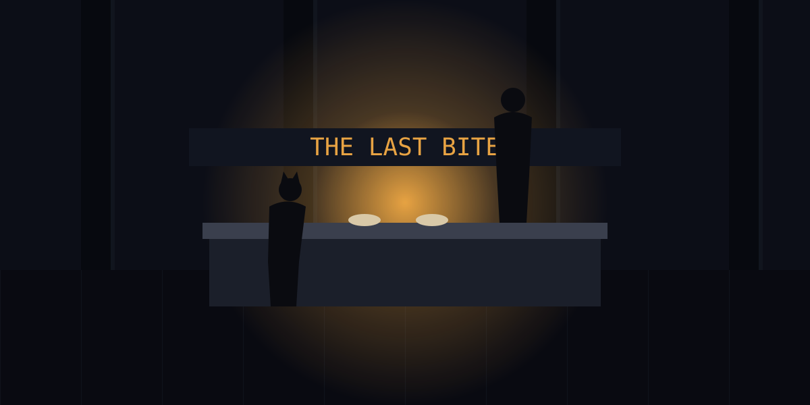

The lights on Concourse C are amber and dying, but the Last Bite's sign is on and the stove is lit. Pell slides a bowl across the counter without being asked. "Eat. Nobody runs on empty."

The broth tastes of ginger and smoke and the ozone that's in everything now. You eat with your back to the wall and the spindle under your arm, and for the length of a bowl, the Hub is just a place where someone is cooking.

---

### Event

**A working terminal**

One terminal on Platform 5 is whole, awake, and not yet aware of the lockdown. You read the sweep's position off its maintenance feed like a weather report: Concourse A cleared, B in progress, drones concentrating on the east stairs.

You memorize it and crack the screen with your elbow so nobody else can. It feels like vandalism. It is survival.

---

### Event

**The commuters share their food**

Thirty commuters have made a camp on Platform 3 out of coats and shopping bags, and when you pass through, a hare-folk grandmother presses a rice ball into your hand without asking who you are.

"Everyone's running from something tonight," she says. You eat it in a stairwell and think about the ghost ledger, and the platform these people waited on, and why.

---

### Event

**A friendly maintenance drone**

Not every drone in the Hub answers to the Authority. This one is a maintenance unit older than the lockdown, trundling along the cable run fixing what it can, and when it finds you it offers a diagnostic port and, somehow, a cup of water.

You patch your splice kit from its spares. It hums at you in a tone you'd swear was approval and rolls on into the dark, and you feel briefly, absurdly, less alone.

---

### Event

**The old crawlway map**

Scratched into the wall of the service corridor, in the hand of some wirephreak from before your time: a map of the Hub's crawlways, every grate and junction and dead end, with Gate 7 marked by a small drawn star.

You copy it onto your forearm in marker. Whoever drew it was running too, once. You hope they made it. You hope you do.

---

### Event

**A clean splice kit in a locker**

A staff locker in the sealed platform's break room, its lock long since rusted, holds a splice kit in Authority grey: clean jacks, fresh decoy cores, a set of picks that make yours look like teeth.

You take it all. The Authority can bill you.

---

### Event

**Pell's radio**

Pell keeps a radio under the counter tuned to the sweep's own channel, and she lets you listen while you eat. Bored voices, overtime complaints, a sergeant saying "Concourse C after the shift change, not before, I'm not paying double."

That's a shorty of grace. You thank her. She tells you to finish your noodles.

---

### Event

**The ad-wall goes dark**

For reasons nobody will ever explain, the screaming ad-wall on Concourse A goes dark, all at once, and the silence it leaves is so large that two mercsercs stop walking to look up at it.

You use the moment. By the time it flickers back to life, selling someone a pleasure den, you are three pillars further toward the gate and nobody has noticed the difference.

---

### Event

**A kit with a flashlight**

A rabbit-folk kit, separated from her family in the lockdown, is sitting under a dead escalator with a flashlight and a very firm expression. She shines it in your face and asks if you're a bad guy.

You say you're a wirephreak. She considers this and decides it's acceptable, and walks you to the service stairs because she "knows the way." She does. You leave her with the commuters on Platform 3 and a promise you intend to keep.

---

### Event

**Drift Gate 7 cycles**

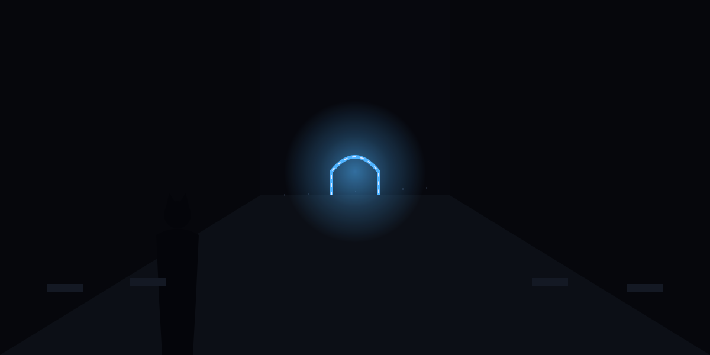

From the end of Platform 6 you see it for the first time: Drift Gate 7, at the far end of the dark Burrows platform, its ring of lights turning slow and uneven, flickering, stubborn. Alive.

It is further than you hoped and closer than you feared. You watch one whole cycle, the ring going from amber to blue and back, and you fix the rhythm in your head like a song.

---

### Event

**Rain on the skylights**

High above the main hall the skylights, cracked and filthy, are streaming. Rain on the Tech District, drumming on the glass, running in long neon-lit streaks down the pillars.

You stand in the dark under it for a tick longer than is wise. You grew up under these skylights. The Hub, whatever it has become, is still the roof you remember.

---

### Event

**The Authority's apology plays on loop**

Every working speaker in the Hub begins, at once, to play an Authority apology: "We regret the inconvenience. Your journey matters to us." Warm voice, soft music, over and over.

Commuters laugh. Then they boo. Then they throw things at the speakers. A mercserc on Concourse B tries to look dignified and fails. You walk through the noise like it's cover, because it is.

---

### Event

**A sealed platform's vending machine**

The vending machine on the sealed platform has not been emptied since before the collapse, and when you splice its lock it opens like a treasure chest: ration bars, canned tea, a single unbroken bottle of real water.

You drink half the water standing there and carry the rest to the commuters. The ration bars taste like the inside of a boot. You eat two.

---

### Event

**Pell tells you about the Luminary tattoo**

Between bowls, Pell shows you the tattoo under her fur: the Luminary sigil, old and blurred. "Kept the gates for them, before. Then for the Authority. Then for whoever was hungry." She shrugs. "Gates don't care who keeps them. People do."

You ask why she's helping. She says she's tired of lying boards. That's all. It's enough.

---

### Event

**A drone looks the other way**

The sweeper drone drifts into the kiosk where you're hiding, red eye sweeping, and stops. You hold your breath. Its eye flickers, glitches green for a tick, and it turns and drifts out again as if it had seen nothing worth reporting.

You will never know whether that was luck, or the Hub, or a wirephreak somewhere with a sense of humor. You thank all three.

---

### Event

**The ghost ledger, read by lamplight**

In a maintenance closet with a lamp between your knees, you read a page of the ghost ledger off the spindle: a column of platform numbers, a column of prices, a column of who paid. The Burrows platform appears forty times. Each time, the price is in someone else's favor.

You close it and sit for a while in the dark. Then you put the spindle back against your ribs, where it belongs, and get up.

---

### Event

**Commuters jam the cameras**

The commuters on Platform 3 have organized. Coats over cameras, shopping bags over drones' lenses, a hare-folk grandmother with a can of spray paint and no fear at all. For a shorty, Platform 3 is dark to the Authority.

"Go on," she says, when she sees you. "We've got this one." You go. You hear the paint can hiss behind you like a blessing.

---

### Event

**A dry coat from the lost and found**

The lost and found behind the information desk has been abandoned since the collapse. Among the umbrellas and the single shoes, you find a dry coat in Authority grey with a maintenance badge still clipped to it.

It's a size too big. It's the best disguise in the building. You put the spindle in its inside pocket and feel, for the first time tonight, like you might pass for someone who belongs.

---

### Event

**Pell's back room**

Pell lets you sleep an hour in the Last Bite's back room, among the noodle crates, with the stove's warmth coming through the wall and the sweep's channel murmuring on the radio.

You dream of trains. When she wakes you, there's a bowl waiting and a fresh dressing for your arm. "Shift change in a shorty," she says. "Move when they do."

---

### Event

**The gate's timing**

With the cycle timing from the junction box and the crawlway map on your arm, you work it out on the back of a ration wrapper: the gate opens for six ticks every third cycle. Six ticks is enough. Six ticks, if you're already in the crawl.

You fold the wrapper into your coat with the spindle. A plan is a thin thing. It is the thinnest thing you have ever been glad of.

---

### Event

**Mercsercs arguing about overtime**

Two mercsercs at the east stairs have stopped sweeping to argue about whether the lockdown counts as overtime or hazard pay. It is a long, detailed, deeply felt argument.

You go past them in the maintenance coat with your head down. One of them nods at you. You nod back. The Authority's greatest weakness, it turns out, is its payroll.

---

### Event

**The kit's family**

The rabbit-folk kit from under the escalator finds her family on Platform 3, and the sound she makes carries across the whole concourse. Her mother looks over the kit's head at you and mouths thank you.

You raise a hand. It cost you nothing. It is the only thing tonight that has.

---

### Event

**A message from the crew**

Your splice kit chimes once, a burst on the old crew frequency that should be dead: three notes, the all-clear, and then a fourth that means we're out. The crew got clear of the Authority's dragnet while the Hub was busy with you.

You put your forehead against the cool tile and breathe. Now the spindle only has to save you.

---

### Event

**The Authority's drones recharge**

At the shift change, every sweeper drone in the Hub drifts back to its charging rack on Concourse A at once, red eyes dimming to pink, a flock going home to roost.

The Hub is blind for a shorty. You have never moved so fast or so quietly. By the time the first eye brightens again, you are a concourse closer to the gate and nobody saw you go.

---

### Event

**The platform where the Burrows waited**

The Burrows platform is the last one before the gate, and it is exactly as the ghost ledger said: dust on the benches, a timetable board that never changed, a child's mitten left on a seat a stretch ago. Nobody has swept it. Nobody was ever going to.

You pick up the mitten. You put it in your coat with the spindle. When the ledger goes public, you want to remember what it was for.

---

### Event

**Pell kicks the relay**

From the far end of the platform you hear it: a bang of boot on metal, then another, then the gate's ring brightening by one stubborn segment. Pell, on the other side of the Hub, keeping her word with her heel.

You laugh out loud in the dark. The gate turns. You start running.

---

### Event

**Quiet in the cable trench**

The cable trench under Platform 6 is the quietest place in the Hub: no speakers, no drones, just the hum of power in the walls and the drip of rain finding its way down. You sit in it for a shorty with the spindle in your lap.

Above, the Authority is tearing its own house apart looking for you. Down here, the old wiring hums the way it did when you were a kit with your ear to the platform edge, listening for trains.

---

### Event

**Someone else's star**

On the wall beside the service crawl behind Gate 7, under forty stretches of grime, someone has scratched a small star, the same one from the crawlway map. Under it, a date from before the collapse, and the words MADE IT.

You add your own star beneath it. You don't add a date. Not yet.
