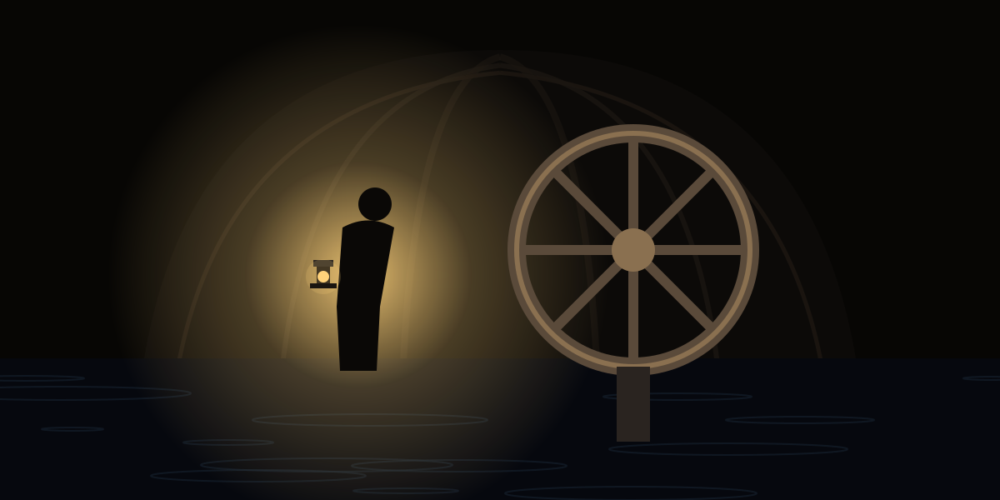
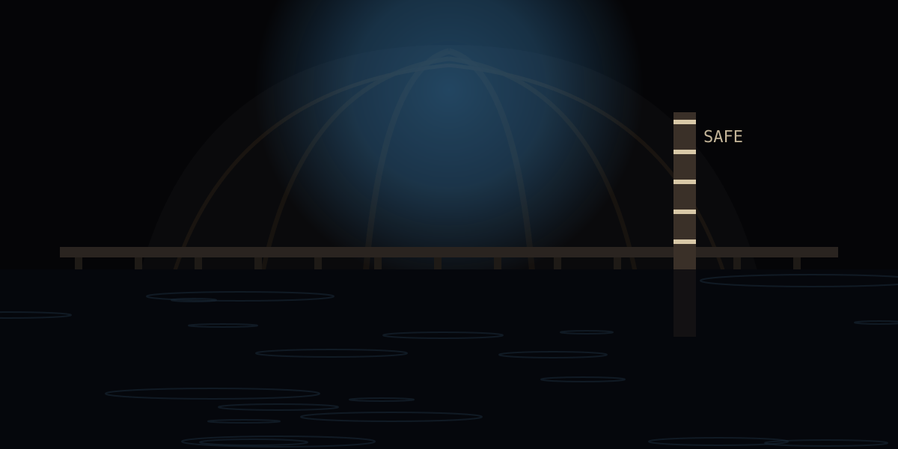
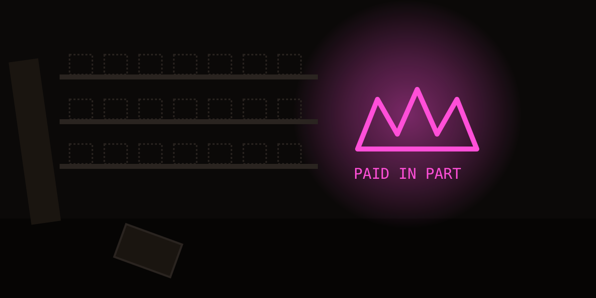
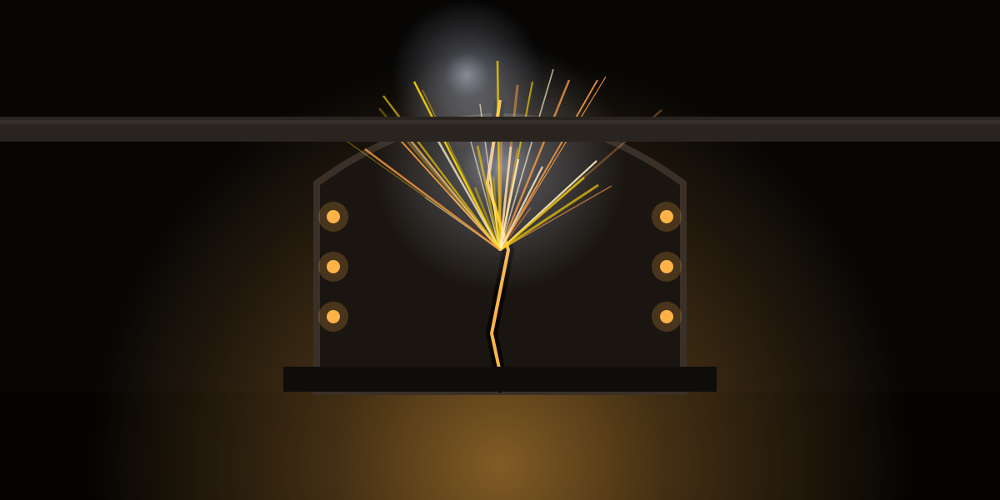
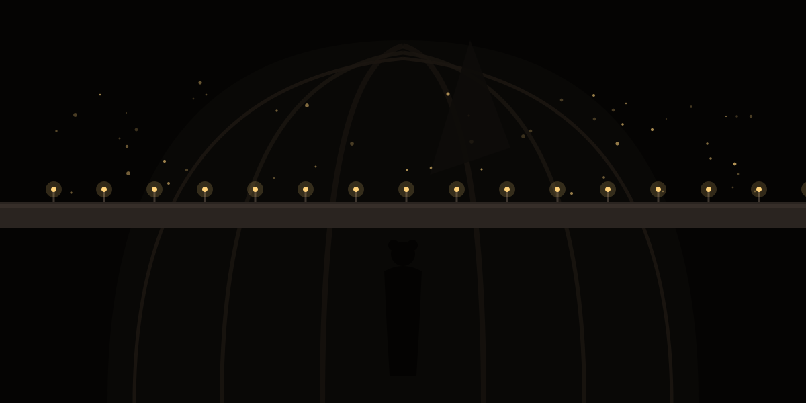
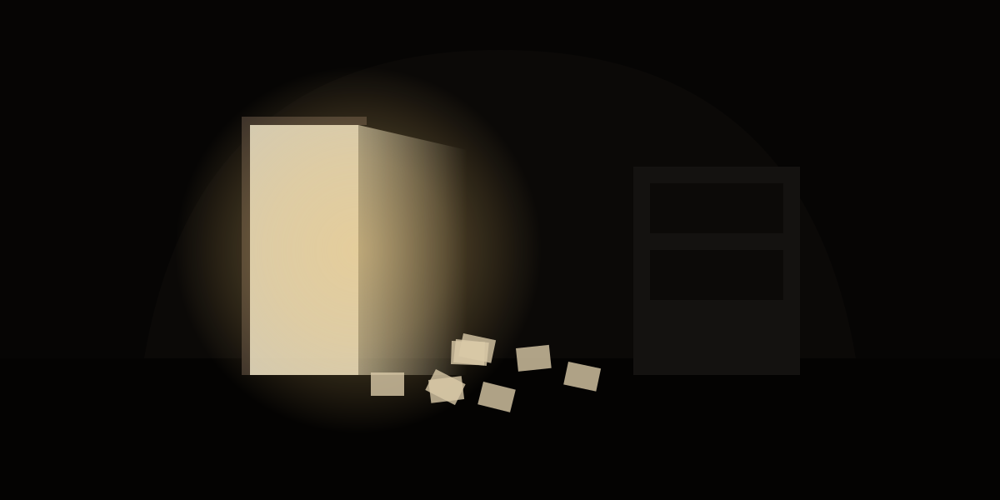
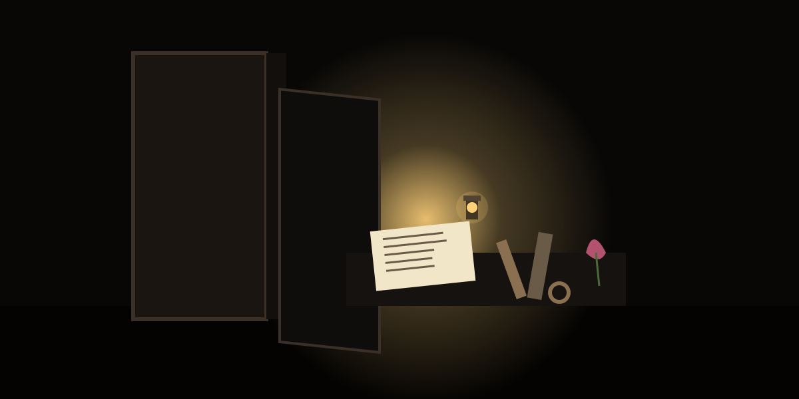
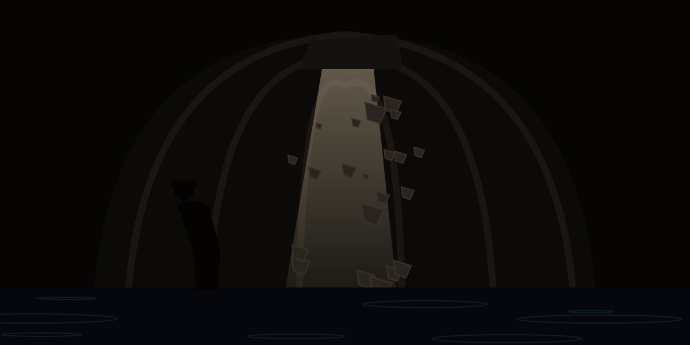
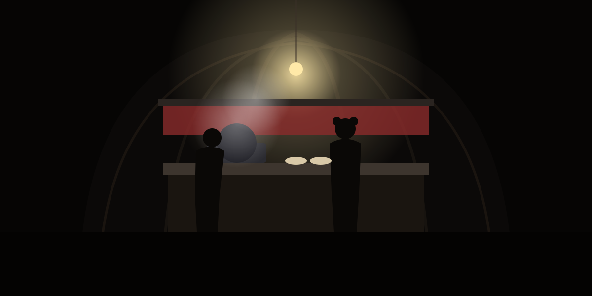

## Who You Are

You are a rat-folk Sporos, a patchhead of the old school: splices, gaskets, a wrench your father wore smooth. You keep the pump-heart of Deepwarren, the lowest gallery of the Burrows, a pre-collapse Luminary machine that nobody alive understands and everybody alive depends on. It lifts the black water out of the tunnels and pushes stale air through the scrubbers. When it coughs, three hundred DimmCitz hold their breath.

You are not a hero. You are the one who knows which valve sticks.

## What Happened

The Black Rains came early this stretch, and they came hard. The upper warrens sealed their hatches to keep the water on your side of the iron. Then the pump-heart threw its first bolt, and the Neon Lords' collectors came down the stairwell to say the warren's last fuel cells would make a fine payment on a debt nobody remembers taking.

Now the water is climbing the gallery markers a hand a day, the scrubbers are wheezing black, and the only people who ever knew the machine's second heart are dead or gone. Probably.

## Your Goal

Keep the pump-heart alive until the rains pass, or wake its second heart and drain Deepwarren for good. Every tunnel you crawl, every splice you make, every deal you cut draws water, rust, or the collectors a little closer. If the fourth gallery floods, the warren drowns in the dark with you in it.

---

## Card Deck

### Primary Success

**You find Old Mottle, the Luminary who built the second heart**

Behind a rusted bulkhead in the flooded east gallery, past a door the maps call a wall, a lantern burns. A mole-folk sits beside a valve wheel taller than she is, blind eyes turned to the sound of your boots in the water. Her coat is stitched with the Luminary sigil, the one the kits scratch on pipes for luck.

"Took you long enough," she says. "I built the second heart. Put my own hands in it. It'll turn if somebody young does the climbing."

She smells of old oil and mushroom tea, and she knows the machine the way you know your own teeth. For the first time since the rains began, you can hear a way out: not a rescue, a plan. She'll need parts, time, and someone to keep the collectors off the stairwell. But hope has a sound, and it's a blind woman humming over a schematic.

---

### Failure Counter

**The black water reaches the second gallery**

You wake to the sound before you see it: a slow, patient slap against iron. The walkway in the second gallery is under a hand of water, and the painted marker your father put on the wall, the one that says SAFE in his crooked letters, is a smear under the surface.

The water is cold enough to make your teeth ache and it smells of rot and rust and something sweet underneath. Families are moving up a level, dragging mattresses that will never dry. The pump-heart groans against the weight and keeps lifting. For now.

---

### Failure Counter

**The collectors take the fuel cells**

The storeroom door hangs off one hinge. The racks where the warren's fuel cells sat, the ones you'd been feeding the pump-heart a sip at a time, are empty down to the dust outlines. Sprayed across the back wall in pink that glows in the dark: the Neon Lords' crown, and under it, PAID IN PART.

They didn't even hurry. Somebody told them where the cells were and when you'd be in the sump. You stand in the doorway counting the ticks the pump has left on what's in its belly, and the number is smaller than the number of days until the rains stop.

---

### Failure Counter

**The hatch to the upper warrens is welded shut from above**

You climb the long ladder to the upper hatch with a list of what you need and a speech about neighbors. You never get to give it. The hatch rim is a bright, ugly seam of fresh weld, still warm. Somebody up there decided that whatever happens to Deepwarren happens to Deepwarren.

You press your ear to the iron. Footsteps. A voice, muffled, saying sorry to no one in particular. Then nothing but the drip of condensation down the rungs. The way out is now a wall, and the only direction left is down, toward the water.

---

### Failure Counter

**The pump-heart cracks**

It happens on a quiet shift. A sound like a bone breaking in a cathedral, then the pump-heart's casing opens along a seam that was never meant to open. Steam screams out white. Sparks chase each other up the conduit and the lights in every gallery go amber, then brown.

You throw every bypass you have. The machine shudders, catches, and limps on at half a heartbeat, bleeding oil onto the grate. It is not dead. It is dying, and the difference is measured in days you no longer have. The water in the second gallery stops falling and starts, very slowly, to climb again.

---

#### Narrative: skip-damage

**The warren sings you through**

The kits learned the old tunnel-song from their grandmothers: a count of turns and knocks that tells you where the ceiling is rotten and where the ground is good. You never believed in it. Tonight, with the lamp dying and the Rib Gallery groaning overhead, you hear them singing it along the pipes from three galleries up, thin and brave.

You follow the song. Left at the third knock, low under the fourth. Behind you, exactly where you would have stepped, a slab of ceiling lets go into the water with a sound like applause. You come out the other end untouched, shaking, laughing, with the song still going.

Sometimes the warren keeps its own.

---

#### Narrative: return-king

**A door the map forgot**

Behind a cabinet of dead batteries, there is a draft. You follow it with your palm along the wall until your fingers find a seam, and the seam is a door, and the door opens onto a dry service gallery the maps gave up on a stretch ago.

It runs under the whole warren. There is a drain here that still drains, a bypass valve that still turns, a route past the stairwell the collectors watch. Something that looked finished is suddenly not finished. You stand in the draft with your heart going fast and start thinking about what you can undo.

---

### Narrative

**The Luminary's last letter**

In a locker rusted shut for longer than you've been alive, you find a letter, a set of tools, and a dried flower nobody could have grown down here. The letter is from the Luminary who built the pump-heart, written to whoever would keep it after her.

"It will break. Everything we made breaks. Keep it anyway. The city don't love you, and that is what makes you dangerous: nobody is coming, so you get to decide what happens."

You read it twice by lantern light and put it in your coat, over your heart, where the warmth is. Then you pick up her tools.

---

### Challenge

**The Rib Gallery comes down around you**

The Rib Gallery got its name from the curved iron supports that hold it up, and tonight the ribs are groaning like something trying to breathe. You're halfway across with a sack of gaskets when the first one gives.

Dust, then water, then the dark. You crawl over a slab with your tail between your teeth and come out coughing grit, lamp cracked, one boot gone to the mud forever. The gaskets made it. You almost didn't.

---

### Challenge

**A flood surge sweeps the sump walkway**

A sound comes down the pipe like a train that forgot how to stop. The surge takes the sump walkway and you with it, slamming you against a valve stand, spinning you through water that tastes of rust and sewage and cold.

You hook an elbow on a chain and hang there until the water drops, lungs burning, counting the ticks. When it passes, you are still in the warren and the warren is still here. That is the whole of the good news.

---

### Challenge

**A collector's shakedown in the market tunnel**

The collector is a stoat-folk in a coat too clean for the Burrows, flanked by two patchheads who used to be your neighbors. He wants a tithe for the Neon Lords: filters, cells, or teeth, his choice.

You pay in filters and take a boot to the ribs for arguing. Lying in the puddle after, you hear him tell the market, kindly, that the water doesn't care who's loyal. Neither, it seems, do the Lords.

---

### Challenge

**The rope bridge over the cistern lets go**

The old rope bridge across the cistern has held for a stretch of stretches, and tonight it holds for exactly half of you. The far anchor tears out of the wet concrete and you swing into the wall hard enough to see neon behind your eyes.

You climb the slack rope hand over hand with the cistern yawning black below you, smelling of ozone and old rain. Your palms are raw to the meat when you reach the lip. The crossing is gone. The long way round just got longer.

---

### Challenge

**A pocket of sump gas**

The lamp flame goes tall and blue before you understand why, and by then your head is already swimming. Sump gas, pooled in a low gallery, sweet and heavy and patient.

You stagger out on your knees with your vision full of sparks, retching into the water. The headache stays for a shorty and the fear stays longer. The gas is still down there, waiting for the next lamp.

---

### Challenge

**The Grey Tails claim the south passage**

The Grey Tails are rats like you, hungrier and better armed, and they have decided the south passage is theirs now, pump or no pump. You get a bottle thrown at you for walking it, then a length of pipe.

You bleed on the way back and make a note on the wall map in your head: another route gone, another family of neighbors turned into a border. The warren is shrinking from the inside.

---

### Challenge

**The pump-heart throws a bolt**

You are tightening the number-three coupling when the pump-heart decides to object. A bolt the size of your thumb comes out of the casing like a bullet and the steam behind it finds your forearm.

The burn blisters before you reach the cold tap. You wrap it in a rag that was clean once and go back to the coupling, because the alternative is the water. The machine hums on, unrepentant.

---

### Challenge

**A bad splice bites**

The relay panel was patched by a patchhead who has since left the warren, and whatever they did, they did it drunk. You touch two wires that should have been dead and every muscle in your arm turns to stone.

When you come to, you're on the grate with your tongue bitten and your fur standing up, and the panel is smoking gently. You fix it properly this time, one-handed, with the other hand shaking.

---

### Challenge

**The grate under you gives way**

Rust is quiet work. The grate over the drainage channel looks like every other grate until it isn't, and then you're waist-deep in black water with a shin laid open on the broken edge.

You haul yourself out and sit shaking in the dark with your boot filling up with blood. Later you'll need the market medic. Now you need to move before whatever lives in the channel comes to see what fell in.

---

### Challenge

**Eels in the sump**

They were pets once, somebody's bright idea from a Neon District stall, and the sump made them something else: long, pale, electric when they want to be. You wade into the pump intake to clear a blockage and the water lights up around your legs.

The shocks come fast and stupid-strong. You clear the blockage anyway, screaming through your teeth, because the intake is the warren's throat. You come out with your legs numb to the hip and a new respect for the dark water.

---

### Challenge

**The scrubber coughs black spores**

The number-two scrubber has been wheezing for days. Tonight it clears its throat and the gallery fills with a soft black snow that tastes of mold and metal.

You cough until you see stars. The kits cough worse. You tear the filter housing open with your bare hands and find the filter is a solid cake of rot. By the time you've swapped it, your chest sounds like the scrubber did.

---

### Challenge

**Caught in a closing hatch**

The galleries' pressure hatches were built to save air, not legs. A surge in the lower sump trips the sensor and the hatch to the market tunnel starts to close while you are halfway through it.

You throw the gasket sack and dive. The iron rim catches your ankle and lets go a half-tick later, which is the only reason you still have the ankle. On the far side you lie listening to the hatch seal with a hiss, counting your bones.

---

### Challenge

**A kit is missing in the flooded rooms**

Little Brindle, six stretches old, went looking for her cat in the east galleries, and the east galleries are chest-deep and dark. You go in with a lamp and a rope and your own heart loud in your ears.

You find her on a cabinet, soaked, furious, holding the cat. Getting back costs you a fall down a flooded stair that leaves your shoulder wrong for days. She tells everyone you were brave. You remember the water closing over your head.

---

### Challenge

**The market medic cheats you**

The market medic is a hare-folk with kind eyes and a cabinet of jars, and the stitches he puts in your shin hold for exactly one shift. The powder he sold you for the pain is chalk.

By morning the wound is hot and angry and the medic's stall is gone. You clean it yourself with boiled water and a swallow of the warren's worst spirit, and the warren's worst spirit does not go gently.

---

### Challenge

**The ladder to the overflow tank gives**

The overflow tank is where the pump-heart puts what it can't lift fast enough, and the ladder to it is older than the tank. Three rungs from the top it folds under you like paper.

You fall into the tank, not the floor, which is the difference between a bruise and a funeral. The water in the tank is warm from the machine and thick with oil. It takes a shorty to find the edge in the dark, and the rest of the night to stop tasting it.

---

### Challenge

**A gasket bursts on the main line**

The main line's gasket was due for a change two stretches ago, and it announces its retirement with a jet of boiling water across the pump room. You are the nearest thing to it.

The scald takes the fur off your forearm in a stripe. You get the isolation valve closed with your eyes shut and your teeth bared. The spare gasket goes in. The pump-heart keeps time. You sit on the floor afterward and shake for a while, and nobody sees, and that's fine.

---

### Event

**A crate of filters behind the false wall**

Somebody long ago hid a crate of scrubber filters behind a false wall in the number-four gallery, sealed in wax paper that crackles when you touch it. They smell of nothing at all, which is the best smell in the Burrows.

You carry them back like a bride. The number-two scrubber gets a clean breath for the first time in a stretch, and so does everyone under it.

---

### Event

**The kits paint the pipes**

The kits have found a crate of Neon District paint, glowing pinks and poison greens, and they've painted the main line from the pump room to the market: fish, suns, a long snake with your face on it, grinning.

You walk the pipe in the dark and it lights your way. "So you can find it when the lamps go," Brindle says, very seriously. You don't tell her it's the nicest thing anyone's done for you this stretch. You think she knows.

---

### Event

**A trader with a working lamp**

The trader is a possum-folk with a cart of everything and a lamp that doesn't flicker, which in Deepwarren is like meeting someone with a private sun. She trades it for your father's second-best wrench and a story about the pump-heart.

The lamp runs on a cell you've never seen, sealed, humming. It will last the rains. You carry it through the galleries and watch faces turn toward it the way plants turn toward anything.

---

### Event

**The noodle stall is open**

Against all sense, the noodle stall in the market tunnel is open. The old badger-folk behind it says the water can come for his stove when it's finished with everything else, and ladles you a bowl of something hot and salty that tastes mostly of pepper and defiance.

You eat standing up with the steam in your whiskers and the pump-heart thumping through the floor. For the length of a bowl, the warren is just a place where people eat.

---

### Event

**The pump holds steady all night**

No alarms. No bolts. The pump-heart finds a rhythm somewhere in its old iron chest and keeps it from one shift to the next, a slow double thump you feel in the soles of your feet.

You sleep four hours straight on the pump-room cot with the sound in your bones. When you wake, the water in the second gallery is a finger lower, and you stand looking at the wet line on the wall for a long time.

---

### Event

**An old song on the pipes**

Someone two galleries up is tapping a song on the main line, an old Burrows lullaby about a rat who swallowed the moon. Somebody else picks it up. Then the kits.

You put your wrench to the pipe and tap the last verse, badly, and the galleries go quiet, and then they laugh. The pump-heart keeps the beat under all of it.

---

### Event

**The mushroom room**

The dry room behind the overflow tank has become a garden without anyone's permission: shelves of bioluminescent fungi, blue and sickly gold, soft as velvet, bright enough to read by.

They're edible, mostly. The gutterdruid who lives in the market tunnel shows you which. You carry baskets back to the families, and for a few days nobody in Deepwarren eats ration paste.

---

### Event

**A pigeon-drone from the upper warrens**

The pigeon-drone comes down the ventilation shaft rattling and lands on the pump-heart like it owns it. Taped to its belly: a note in a child's hand. "We know you're down there. Dad says sorry about the hatch. Here's what we could get."

Three fuel cells, a bag of nails, a jar of honey. Honey. You stand holding the jar and thinking about the people above the weld, and what sorry costs them, and what it buys you.

---

### Event

**The collectors send an invitation**

The card is printed, heavy, pink, with the Neon Lords' crown in gold leaf: an invitation to discuss "the warren's future" over dinner in the Neon District, safe conduct guaranteed.

You read it three times. Nobody who goes to those dinners comes back changed for the better. You put the card on the pump-room wall where you can see it while you work, so you remember exactly who you're keeping the light on against.

---

### Event

**A dead drop of batteries**

Behind the loose brick in the third stairwell, where your father used to leave you sweets, there is a bag of batteries and no note. Somebody who knows the old drops is still thinking about Deepwarren.

They're small cells, lamp cells, enough to light the galleries for a stretch of nights. You leave a thank-you under the brick: a drawing of the pump-heart, and the word HOLDING.

---

### Event

**The Torvells move out**

The Torvells have lived in the number-three gallery for four generations, and tonight they are carrying their grandmother up the stairs to the sealed hatch, to wait by the iron in case it opens.

You help with the mattress. Nobody says the water is coming for their rooms. Old Torvell shakes your hand at the bottom of the ladder and says "Keep it turning, son," and goes up into the dark.

---

### Event

**A wedding in the flooded chapel**

The chapel is knee-deep, so the wedding is held on the pews, two hare-folk patchheads holding hands across the aisle while the preacher balances on the altar rail. Somebody has strung the kits' paint lamps across the water.

You stand at the back with oil on your hands and watch two people promise each other a future in a room that's drowning. It's the most Burrows thing you've ever seen. You cry a little, and blame the sump gas.

---

### Event

**Your father's tools**

In the bottom of the overflow tank, when it drains, you find a canvas roll you thought the water had taken for good: your father's tools, rusted but whole, each one worn to the shape of his hand.

You clean them by lamplight, one by one, and hang them on the pump-room wall where his were. The number-three coupling goes on easier with his spanner. It would.

---

### Event

**The radio catches the Neon District**

A dead radio on the market trader's cart coughs back to life when you kick it, and the Neon District comes pouring out: glitchy ads for pleasure dens, a fight broadcast, a song about chrome and blood with too much bass.

The whole market stops to listen to a world that has already forgotten them. Then the badger turns it off and goes back to his noodles. "Loud up there," he says. "Quiet down here. I know which I'd pick."

---

### Event

**A drawing of you**

Brindle gives you a drawing: you, enormous, with a wrench the size of a tunnel, standing on the pump-heart, which has a smiling face. The water is a small blue scribble in the corner, running away.

You pin it inside the pump-room door. You tell yourself it's for morale. You look at it more than you look at the gauges.

---

### Event

**The rain stops for an hour**

The drip from the ventilation shaft, which has not stopped since the rains began, stops. Everyone in Deepwarren notices at once. The galleries fill with a silence so big it rings.

It lasts an hour. Then the drip returns. But you've heard it now, the sound of after, and you can keep working toward a sound.

---

### Event

**A stranger pays for your bowl**

At the noodle stall, a mink-folk you don't know in a Tech District coat pays for your bowl and leaves without a word. The badger shrugs. "Said you were the one keeping the light on. Said somebody should buy you dinner."

Word travels up ventilation shafts, apparently. You eat the noodles. They taste better paid for.

---

### Event

**The gutterdruid's poultice**

The gutterdruid in the market tunnel, a thin old fox-folk who smells of moss, sees you limping and sits you down without asking. The poultice she packs on your shin is green and warm and smells like the mushroom room.

By morning the wound is clean and closing. She refuses payment and asks instead that you stop cursing the eels. "They're frightened too," she says. You promise. You do not entirely mean it.

---

### Event

**A map on the wall of the dead gallery**

Someone, a stretch ago, painted a map of the whole warren on the wall of the dead gallery, every passage, every drain, every door the current maps forgot. You trace it with your lamp and your mouth open.

Half of it is under water now. The other half tells you things about your own home you never knew. You copy what you can onto the back of the collectors' invitation.

---

### Event

**The scrubber breathes clean**

With new filters and a cleaned housing, the number-two scrubber draws a breath that sounds like a healthy animal for the first time in a stretch. The air that comes out of it is cool and smells of nothing.

Kits put their faces in the vent. Old folk breathe deep and close their eyes. You lean on the housing and listen to the machine you fixed doing what it was made for, and it's better than any medicine the market sells.

---

### Event

**The Grey Tails send back the pipe**

The length of pipe they beat you with comes back down the south passage wrapped in a rag, with a note: WE NEED THE PUMP TOO. Under it, a sack of copper fittings, the kind you can't get anywhere.

It isn't peace. It's arithmetic. You take the fittings anyway, and the next time you pass the south passage, nobody throws anything.

---

### Event

**Night shift with Brindle's mother**

Brindle's mother, a quiet rat-folk named Sedge who used to work the Tech District transit lines, takes the night shift with you without being asked. She reads gauges faster than you do and swears better.

You work in silence mostly. Near dawn she says, "My kid thinks you're a Luminary," and you both laugh, and the pump-heart thumps, and it is the best night shift you've had.

---

### Event

**The stairwell watch**

The warren organizes itself without you: a watch on the collectors' stairwell, four families in shifts, armed with pipes and a very loud bell. Nobody asked you. Nobody needed to.

The bell rings once that night, a false alarm, a drunk hare-folk coming home. Everyone turns out anyway. You stand among them with your wrench and understand you are not keeping the light on alone.

---

### Event

**The water drops a hand**

The pump-heart finds a strength you didn't know it still had and the second gallery drops a full hand in a day. Walkways come up out of the black like the backs of whales. A chair. A boot. A child's drawing, ruined, that someone had pinned too low.

The families watch the wet line sink and don't dare cheer. You dare, quietly, in the pump room, with the door shut.

---

### Event

**A letter to the upper warrens**

You write a letter to the people above the weld and send it up with the pigeon-drone: what the water is doing, what the pump needs, what you'll do if the collectors come back. No pleading. A report.

The drone returns two days later with a spool of wire, a box of fuses, and a second note in the child's hand. "Dad read it out loud. Everybody listened." You pin it next to Brindle's drawing.

---

### Event

**Sedge fixes the gauge**

The pressure gauge on the main line has read a lie for a stretch, and you'd learned to add a quarter in your head. Sedge takes it apart on the cot with a hairpin and a swear word, and puts it back reading true.

The true number is worse than the lie. You'd rather know. You tell her so, and she says that's why she did it.

---

### Event

**Quiet in the market tunnel**

The market tunnel at the dead hour, lamps low, stalls shuttered, the smell of pepper and wet stone. You walk it slowly on your way to the sump, listening to the pump-heart through the floor.

A kit asleep in a doorway opens one eye, sees it's you, and closes it again. That's the whole of it. You walk on, and the sound of the machine follows you like a dog.

---

### Event

**The second heart's schematic**

In the dead gallery, under the painted map, there is a hatch, and under the hatch, sealed in oilcloth, a schematic of the pump-heart's second heart: valves you've never seen, a chamber the pump room's floor must be hiding.

You can't read half of it. You read the other half until the lamp dies. Somewhere under your feet, a machine is waiting to be woken, and now you know its shape.
